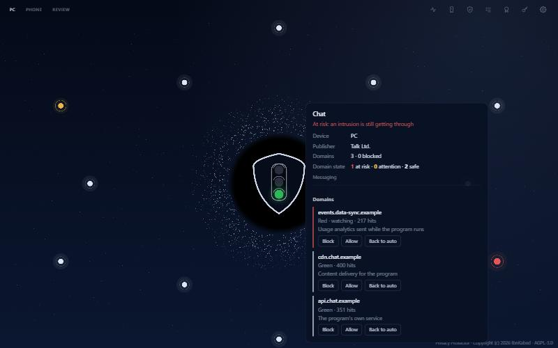
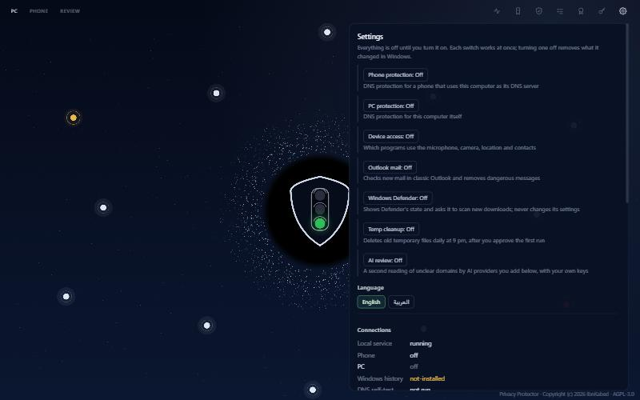

# Privacy Protector

**You choose what is protected.** Privacy Protector is a free, open-source privacy guard for Windows that
can protect your **phone**, your **PC**, or **both**, and you decide which. Every part of it has its own
switch in Settings: turn a protection on and it works at once; turn it off and it stops and undoes
everything it changed in Windows. Nothing is on until you choose it.

- **Phone protection:** your phone uses this PC as its DNS server; trackers and intrusive domains are
  blocked before the phone ever connects to them.
- **PC protection:** the PC's own DNS goes through the same engine, and because Windows records which
  program asked for each name, every domain is tied to the program that called it.
- **Device access:** see which programs used the microphone, camera, location and contacts, and when;
  each kind has its own switch.
- **Optional extras, each off until you want it:** Outlook mail checking, Windows Defender status,
  a daily temp-file cleanup, and an AI second opinion on unclear domains with your own provider keys.

Everything runs on your computer. There is no account, no cloud service and no telemetry.



## Quick start

1. Download **`PrivacyProtector-Setup-<version>.exe`** from
   [Releases](https://github.com/ibnkabed/privacy-protector/releases) and run it. The installer and
   `PrivacyProtector.exe` are built on GitHub Actions directly from this repository (see
   [Code signing policy](#code-signing-policy)); SHA-256 checksums are published with every release.
2. Privacy Protector opens in your browser at `http://127.0.0.1:8733` and asks **what you want to
   protect**: your phone, this PC, both, or nothing yet.
3. If you chose the phone: set your phone's Wi-Fi DNS server to this PC's local address (Settings shows
   it). If you chose the PC: approve the one Windows prompt; your DNS switches to the engine.

To run from source instead (Python 3.12 or newer):

```powershell
git clone https://github.com/ibnkabed/privacy-protector.git
cd privacy-protector
python -m pip install -r requirements.txt
.\Start-Privacy-Protector.ps1
```

## What the application does

| Switch | What it does | What it changes in Windows | Turning it off |
|---|---|---|---|
| Phone protection | Answers DNS for devices on your home network | Two inbound firewall rules for port 53, private networks and your local subnet only | Removes the rules; the engine stops listening on the network |
| PC protection | Answers the PC's own DNS and blocks what the review marks unsafe | The adapters' DNS servers, browser secure-DNS policy, the DNS client log, and a one-minute watchdog task | Restores the saved DNS settings and removes the watchdog |
| Device access | Records microphone, camera, location and contacts use per program | Optionally a task that copies Windows' own access log so it can be read | Stops recording; removes the task |
| Outlook mail | Checks each new message in classic Outlook; removes dangerous mail | Nothing | Stops checking |
| Windows Defender | Shows Defender's state and detections; asks it to scan new downloads | Nothing (it never changes Defender's settings) | Stops reading |
| Temp cleanup | Deletes temporary files untouched for a week, daily at 9 pm, after you approve the first run | Nothing | Stops cleaning |
| AI review | Asks AI providers you add for a second reading of unclear domains | Nothing | No request leaves the PC |

Turning on phone or PC protection, or the Windows access-log copy, asks for administrator approval once
through the normal Windows prompt. If you decline, nothing changes and Settings says so.

**If the engine stops,** the PC's internet keeps working: the watchdog switches the PC to a public
resolver within a minute and back when the engine returns.

### How a domain is judged

1. **The local engine** studies every new domain: a built-in catalog of known trackers and services,
   the shape of the name, which apps call it, and a bounded look at its public HTTPS page. Each domain
   gets a colour (green, orange or red), a reason and a confidence.
2. **The safety gate** keeps anything a program needs to work open: system infrastructure, sign-in,
   certificates, updates, the program's own publisher, and every host or program you trusted in Settings.
3. **Optional AI review** (only if you turn it on and add a provider): a *writer* reads the domain first,
   the *jury* decides, and the *judge* confirms or overturns before anything is blocked. One provider can
   hold all three roles. Built-in protection rules always win over the models: health and fitness data
   belongs to you, attendance apps may use location at check-in, infrastructure is never blocked, and doubt
   never blocks.
   **Without AI review** the built-in catalog decides: documented trackers, ad networks and attribution
   services are blocked automatically, and anything the catalog doesn't know is watched, not blocked.
4. **Only red that is safe to block is blocked.** If a program then insists on a blocked domain in a way
   that shows it needs it, the block is lifted automatically.

## Architecture

```
phone ──DNS──┐                     ┌─► DNS-over-HTTPS upstream (Cloudflare, Google)
             ├─► DNS engine ──────┤
PC ────DNS───┘   (policy, cache)   └─► block (NXDOMAIN) for blocked names
                      │
                      ├─► domain classifier (catalog, evidence, HTTPS metadata)
                      ├─► PC attribution (Windows DNS client log + TCP table)
                      ├─► safety gate ─► optional AI review (writer, jury, judge)
                      ├─► capability monitor (Windows access log, live microphone sessions)
                      └─► dashboard + local API on 127.0.0.1:8733, tray light
```

| Module | Role |
|---|---|
| `dns_engine.py` | UDP/TCP DNS, exact-domain policy, TTL cache, DoH forwarding with failover |
| `domain_classifier.py`, `domain_verdicts.py` | Evidence-based colour, reason and confidence for every domain |
| `pc_protection.py` | PC attribution, safety gate, automatic blocking and its post-block guard |
| `phone_auto.py` | The same automatic blocking for the phone |
| `capability_monitor.py`, `capability_judge.py` | Device-access history and its verdict per program |
| `ai_providers.py`, `ai_reviewer.py` | Optional review with your own providers |
| `user_rules.py`, `user_exceptions.py` | Built-in protection rules, and what you trust |
| `settings.py`, `features.py` | Your switches, and starting or stopping each part |
| `app.py` | The engine process: dashboard server and local API |
| `privacy_protector.py` | The program's entry point (`PrivacyProtector.exe`) |

## User interface

The dashboard is a night sky: each **planet** is a program on the PC or an app on the phone, and its colour
is its state: white when everything intrusive is blocked, yellow when something waits for a decision or
can't be enforced, red when something intrusive still gets through. The **core** in the middle is the
engine itself. Click a planet for its domains and device access, with Block, Allow and Monitor buttons;
click the core for the engine's health.

The bar holds PC / Phone views, Review, Activity, phone permissions, Defender and Outlook, the model log
and usage, model checks, and **Settings**. The interface is in English by default; choose **العربية** in
Settings for a full Arabic interface laid out right to left.



A tray light shows the same state next to the clock: white (nothing to report), yellow (a note), orange
(AI providers reached their daily limit), green (a review is deciding now), red (something needs you).

## Check Developer Mode

With phone protection on and an iPhone paired over USB, **Settings → iPhone → Check developer mode** reads
whether Developer Mode is on. Apps can see when it is, and some refuse to run; it is truly hidden only when
it is off on the iPhone (Settings → Privacy & Security → Developer Mode → Off). The check is read-only: the
app never injects code, never bypasses app checks, and never modifies an app.

## Privacy and transparency

- **Everything stays on this computer.** Domain history, decisions, device-access records and settings are
  in `%LOCALAPPDATA%\PrivacyProtector\data`. Nothing is uploaded.
- **Device access records** hold the program's name and path, the kind of access (microphone, camera,
  location, contacts), and when it started and stopped. They come from Windows' own access log and live
  microphone sessions. They are kept until you delete them; turn the switch off to stop recording.
- **AI review is off by default.** When you turn it on, only the domain name and public facts about it
  (its category, its HTTPS page title, which kind of app calls it) go to the providers you added, never
  a program path, your name, or your files. Your keys are stored only in your local data folder.
- **The dashboard** listens on `127.0.0.1` only, refuses requests that name another host (DNS rebinding),
  and accepts changes only with a per-run session token, so a web page open in your browser cannot drive it.

## Local API

All endpoints are on `http://127.0.0.1:8733`. Requests that change something need the header
`X-Privacy-Protector-Token` with the value from `GET /api/session`.

| Method | Path | Purpose |
|---|---|---|
| GET | `/api/health`, `/api/status` | Engine health and status |
| GET/POST | `/api/settings` | Your switches and language |
| GET/POST | `/api/user-exceptions` | Trusted hosts, programs and apps |
| GET/POST | `/api/ai/providers` | AI providers (keys are never returned) |
| GET/POST/DELETE | `/api/policy` | Phone exact-domain rules |
| GET | `/api/pc/status`, `/api/pc/domains`, `/api/pc/capabilities` | PC protection and device access |
| POST | `/api/pc/decision` | Block, allow or reset a PC domain |
| GET | `/api/classifications`, `/api/logs`, `/api/apps` | Domain study, activity, phone apps |
| POST | `/api/dns/self-test` | DNS self-test |
| DELETE | `/api/dns/cache`, `/api/logs` | Clear the cache or the activity log |

## Storage layout

```
%LOCALAPPDATA%\PrivacyProtector\data\
  settings.json                your switches and language
  policy.json                  phone exact-domain rules
  apps.json                    phone apps you monitor and apps seen in reports
  domain-classifications.json  the study of every domain seen
  dns-activity.ndjson          recent DNS activity
  user-exceptions.json         what you trust
  ai-providers.json            AI providers and keys (only if you add them)
  pc\                          PC policy, domains, decisions, device access, Defender and mail state
```

Set `PRIVACY_PROTECTOR_DATA_DIR` to keep the data elsewhere.

## Runtime requirements

- Windows 10 or 11, 64-bit.
- The installer includes everything. From source: Python 3.12+ and `requirements.txt`.
- Phone protection: the phone and the PC on the same home network, and port 53 free on the PC
  (Windows' Internet Connection Sharing uses it when turned on).
- iPhone USB features (developer-mode check, app list, packet attribution) need an iPhone paired with this PC.

## Uninstall

Use **Settings → Apps → Privacy Protector → Uninstall**. The uninstaller stops the engine and undoes every
Windows change: DNS servers, firewall rules (including version 1's), the watchdog and access-log tasks, and
the sign-in entry. Your data stays in `%LOCALAPPDATA%\PrivacyProtector\data`; delete that folder to remove it.

From a source checkout, run in an administrator PowerShell window:

```powershell
.\Uninstall-Privacy-Protector.ps1
```

Add `-RemoveData` to delete the data too.

## Upgrading from 1.x

Version 1 was a phone-only DNS monitor with a classic dashboard. Version 2 replaces it: it reads the same data
folder, so your rules and apps are kept, and it asks once what you want to protect before changing anything.

## Tests

```powershell
python -m unittest discover -s tests -v
```

The suite runs on Windows in GitHub Actions for every push. It uses only synthetic data and temporary folders,
needs no internet, and includes a scanner that blocks personal data from the repository.

## Known limitations

- Windows only. The phone side works with any phone that lets you set its DNS server; the USB extras are iPhone only.
- DNS-level blocking sees names, not content. An app that uses its own encrypted DNS, or connects to a raw IP
  address, is not filtered (the dashboard lists such addresses but cannot block them by name).
- Windows does not record which website inside a browser used the camera or microphone; it records the browser.
- The AI review can only be as good as the providers you add; the built-in rules and the safety gate stay in charge.
- The Arabic interface translates the dashboard; reasons written by the engine for each domain stay in English.

## Code signing policy

Free code signing provided by [SignPath.io](https://signpath.io), certificate by
[SignPath Foundation](https://signpath.org). Release files are built on GitHub Actions directly from this
repository's tagged source, and signing runs there too; nothing is built or signed on a personal computer.

- **Committers and reviewers:** IbnKabed, the project owner
- **Approvers:** IbnKabed, the project owner
- **Privacy:** this program will not transfer any information to other networked systems unless specifically
  requested by the user or the person installing or operating it. The only connections it makes on its own are
  DNS-over-HTTPS lookups for the names your devices ask for, and a bounded fetch of a domain's public HTTPS page
  title during its study; AI review, when you turn it on, contacts only the providers you configure.

## License

Copyright (c) 2026 IbnKabed

Privacy Protector is free software under the GNU Affero General Public License v3.0 or later; see
[LICENSE](LICENSE) and [NOTICE](NOTICE). Third-party components and their licenses are listed in NOTICE.
